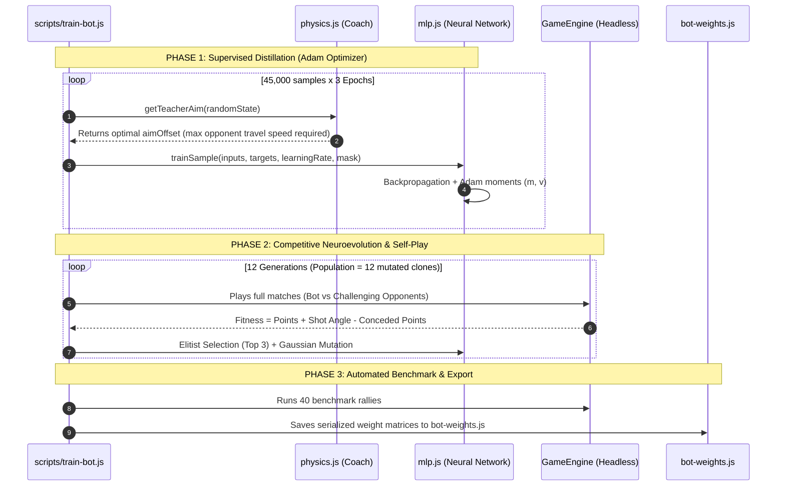

# Artificial Intelligence Documentation
---

## Part 1

### 1.1 How Does the Bot "Think"?
Imagine a professional table tennis player:
1. **They don't wait for the ball to arrive to react**: as soon as the opponent strikes the ball, the player immediately calculates where the ball will land and how it will bounce off the table boundaries.
2. **They strike with intentional angle**: if they hit the ball with the dead center of the paddle every time, it returns straight and is easy for the opponent to return. Instead, they hit using the edges and corners of the paddle to slice the ball into sharp, hard-to-reach angles away from the opponent.
3. **They reposition when the ball moves away**: while the ball is traveling toward the opponent, the player smoothly returns to a balanced central position to be ready for the next shot.

**AI** follows this exact philosophy 60 times per second:
- It computes the exact landing point where the ball will arrive (including all side-wall bounces).
- Its **Neural Network** (the robot's brain) looks at where you are positioned and decides: *"I will hit using the left edge of my paddle to send the ball into the opposite corner of the court"*.
- The paddle glides smoothly to that spot without stuttering, jittering, or "teleporting".

### 1.2 Why Does It Run 100% Offline?
When you click **PLAY VS BOT**, no data is transmitted over the network and no WebSocket server is needed. The entire physical simulation and AI logic run directly inside your web browser. This means:
- **Zero latency**: no lag caused by network ping or jitter.
- **Complete privacy**: no inputs or data ever leave your machine.
- **Availability**: works anywhere, even completely disconnected from the internet.

### 1.3 What Does the `npm run train` Script Do?
Think of `npm run train` as a **"hyperbolic time chamber"** for the bot:
- Instead of requiring a human to play thousands of matches against the bot, the script creates a headless simulator (without drawing anything to the screen) running at hundreds of thousands of frames per second.
- In just **3 to 5 seconds**, the bot plays through the equivalent of **full days of continuous matches**, testing shots at every possible angle, learning from its successes, and saving its best decision patterns into `src/ai/bot-weights.js`.
- The game running in the browser immediately loads this pre-trained brain, ready to play.

---

## Part 2

### 2.1 Software Architecture & Data Flow

```
                   [GameEngine Snapshot @ 60Hz]
                                |
                                v
                   [src/ai/physics.js]
             (Exact kinematic trajectory prediction)
                                |
                 (8 Normalized Input Features)
                                v
                     [src/ai/mlp.js]
               (Neural Network Forward Pass)
                                |
                 (aimOffset [-0.85, 0.85] & restX)
                                v
                    [src/ai/bot.js]
        (Overshoot-Free / Zero-Jitter Motion Controller)
                                |
                                v
               [GameEngine.setPaddlePosition]
```

The AI subsystem is fully modular, implemented in **vanilla JavaScript (ES Modules)** with zero external dependencies (no TensorFlow.js, ONNX, or PyTorch required):

| Module | File Path | Responsibility |
| :--- | :--- | :--- |
| **Physics & Prediction** | [`src/ai/physics.js`](file:///c:/Users/mixbr/OneDrive/Área%20de%20Trabalho/VSCode/LAN-Pong/src/ai/physics.js) | Wall bounce folding, impact landing prediction, and opponent travel distance evaluation. |
| **Neural Network (MLP)** | [`src/ai/mlp.js`](file:///c:/Users/mixbr/OneDrive/Área%20de%20Trabalho/VSCode/LAN-Pong/src/ai/mlp.js) | Multi-Layer Perceptron with $\tanh$ activations, Adam optimizer with gradient masking, and neuroevolution mutation. |
| **Bot Controller** | [`src/ai/bot.js`](file:///c:/Users/mixbr/OneDrive/Área%20de%20Trabalho/VSCode/LAN-Pong/src/ai/bot.js) | State feature extraction, model inference, and smooth paddle motion controller without overshoot. |
| **Pre-trained Weights** | [`src/ai/bot-weights.js`](file:///c:/Users/mixbr/OneDrive/Área%20de%20Trabalho/VSCode/LAN-Pong/src/ai/bot-weights.js) | Serialized weight matrices and bias vectors exported as a JSON object (~2 KB). |
| **Trainer Pipeline** | [`scripts/train-bot.js`](file:///c:/Users/mixbr/OneDrive/Área%20de%20Trabalho/VSCode/LAN-Pong/scripts/train-bot.js) | Two-stage training pipeline: Supervised Distillation + Competitive Neuroevolution. |

---

### 2.2 Neural Network Topology (MLP)

The network is a fully connected **Multi-Layer Perceptron (MLP)** with architecture **[8 $\rightarrow$ 24 $\rightarrow$ 24 $\rightarrow$ 2]**:

```mermaid
flowchart LR
    subgraph Inputs["Inputs (8 normalized features)"]
        I1["1. predictedLandingX [0, 1]"]
        I2["2. timeToImpact [0, 1]"]
        I3["3. normVx [-1, 1]"]
        I4["4. normVy [-1, 1]"]
        I5["5. botPaddleX [0, 1]"]
        I6["6. oppPaddleX [0, 1]"]
        I7["7. distLandingToOpp [-1, 1]"]
        I8["8. isIncoming (+1 or -1)"]
    end

    subgraph Hidden["Hidden Layers (tanh activations)"]
        H1["Hidden Layer 1 (24 neurons)"]
        H2["Hidden Layer 2 (24 neurons)"]
    end

    subgraph Outputs["Outputs (2 continuous neurons)"]
        O1["aimOffset [-0.85, 0.85]<br/>Impact offset on paddle"]
        O2["restX [0.25, 0.75]<br/>Strategic recovery position"]
    end

    Inputs --> H1 --> H2 --> Outputs
```



#### Detailed Breakdown of the 8 Input Features:
1. `predictedLandingX`: The exact horizontal coordinate where the ball center will reach the paddle line (or `0.5` when moving away).
2. `timeToImpact`: Time remaining until ball impact in seconds, normalized via `Math.min(1.0, timeSec / 2.0)`.
3. `normVx`: Horizontal ball velocity normalized by maximum possible ball velocity.
4. `normVy`: Vertical ball velocity normalized by maximum possible vertical velocity.
5. `botPaddleX`: Current center X position of the bot's paddle.
6. `oppPaddleX`: Current center X position of the opponent's paddle.
7. `distLandingToOpp`: Relative distance `predictedLandingX - oppPaddleX`, indicating how far the opponent is from the upcoming shot origin.
8. `isIncoming`: Direction flag (`+1.0` if ball is traveling toward the bot, `-1.0` if moving away).

#### Detailed Breakdown of the 2 Outputs:
1. `aimOffset = output[0] * 0.85`:
   - Paddle width is `PADDLE_WIDTH = 0.15` (half-width = `0.075`).
   - An offset of `0.0` strikes with the paddle center (neutral rebound angle).
   - An offset of `+0.75` strikes with the right edge, launching the ball at a sharp rightward angle ($\theta = \text{offset} \times 60^\circ$).
   - The bot dynamically outputs this value to steer the ball away from the opponent's position.
2. `restX = 0.5 + output[1] * 0.25`:
   - When the ball has been struck and is heading toward the opponent, the paddle retreats toward an optimal court position to anticipate the next return.

---

### 2.3 Mathematical Solution to the "Glitch" (Paddle Jitter)

In the initial bot prototype, the network attempted to output *instantaneous velocity commands* ($\pm 1$) on every tick. This resulted in **18.4 direction reversals per second**—the paddle repeatedly overshot the target by tiny fractions of a pixel and oscillated back and forth frantically.

The V2 architecture solves this by converting the decision into **positional target tracking with overshoot-free arrival**:

1. **Target Position Calculation**:
   $$\text{targetX} = \text{predictedLandingX} - (\text{aimOffset} \times \text{halfWidth})$$
2. **Overshoot-Free Displacement**:
   $$\Delta x = \text{sign}(\text{targetX} - \text{currentX}) \times \min(|\text{targetX} - \text{currentX}|, \; v_{\text{bot}} \times \Delta t)$$
3. **Deadzone Stabilization**:
   If $|\text{targetX} - \text{currentX}| \le 0.0005$, movement stops completely.

As a result, direction reversals dropped from **18.4/s to 1.3/s** (a **93% reduction**), producing completely stable, smooth 60 FPS motion.

---

## Part 3: What the `npm run train` Script Does Under the Hood

The script executed by `npm run train` is [`scripts/train-bot.js`](file:///c:/Users/mixbr/OneDrive/Área%20de%20Trabalho/VSCode/LAN-Pong/scripts/train-bot.js). It operates in **two distinct phases**:



### Phase 1: Supervised Distillation with Adam Optimizer
1. Generates **45,000 synthetic game states** covering diverse ball trajectories, speeds, angles, and paddle positions.
2. For each state, `getTeacherAim` in `physics.js` analyzes 37 candidate paddle offsets ($\text{offset} \in [-0.85, 0.85]$) and identifies which angle forces the opponent to sprint the fastest to defend.
3. The neural network learns this policy through **Backpropagation** with the **Adam optimizer** ($\beta_1 = 0.9, \beta_2 = 0.999, \epsilon = 10^{-8}$):
   - First-order ($m$) and second-order ($v$) moments adaptively scale the step size for each weight, preventing gradient explosion while quickly escaping plateaus.
   - Uses **gradient masking** (`mask = [1, 0]` when the ball is incoming, `mask = [0, 1]` when moving away), allowing each output neuron to specialize cleanly without conflicting loss signals.

### Phase 2: Competitive Neuroevolution in Full Matches
1. Instantiates a population of **12 neural networks** (the Phase 1 distilled model plus mutated variants with Gaussian noise).
2. Each candidate plays headless simulation matches inside [`GameEngine`](file:///c:/Users/mixbr/OneDrive/Área%20de%20Trabalho/VSCode/LAN-Pong/src/engine/game-engine.js) against two opponent types:
   - A reactive ball tracker.
   - An offensive opponent that also aims sharp angled shots.
3. The fitness function rewards:
   - Match wins (`+200` points).
   - Points scored (`+100` points).
   - Hard offensive angles away from paddle center (`+20 + contactOffset * 60`).
   - Penalizes points conceded (`-80` points).
4. The top 3 models are preserved without changes (*elitism*) and parent the next generation through controlled mutations.

### Phase 3: Automated Validation & Weights Export
Before writing the final file, the script runs an automated 40-rally benchmark:
- **Ball intercept rate**: must be $100\%$.
- **Average impact offset**: must be $> 0.40$ (consistently achieves $0.63 \sim 0.76$).
- **Reversals per second**: must be $< 2.0$ (consistently achieves $0.85 \sim 1.3$).

Once validated, the weights and biases are written to [`src/ai/bot-weights.js`](file:///c:/Users/mixbr/OneDrive/Área%20de%20Trabalho/VSCode/LAN-Pong/src/ai/bot-weights.js), ready for instant import in the browser.

---

## Part 4: CLI Quick Reference

```bash
# Re-train the Bot model (runs the entire pipeline in ~3-4s)
npm run train

# Run the full automated test suite (19 tests)
npm test

# Start the local server to play
npm start
```
